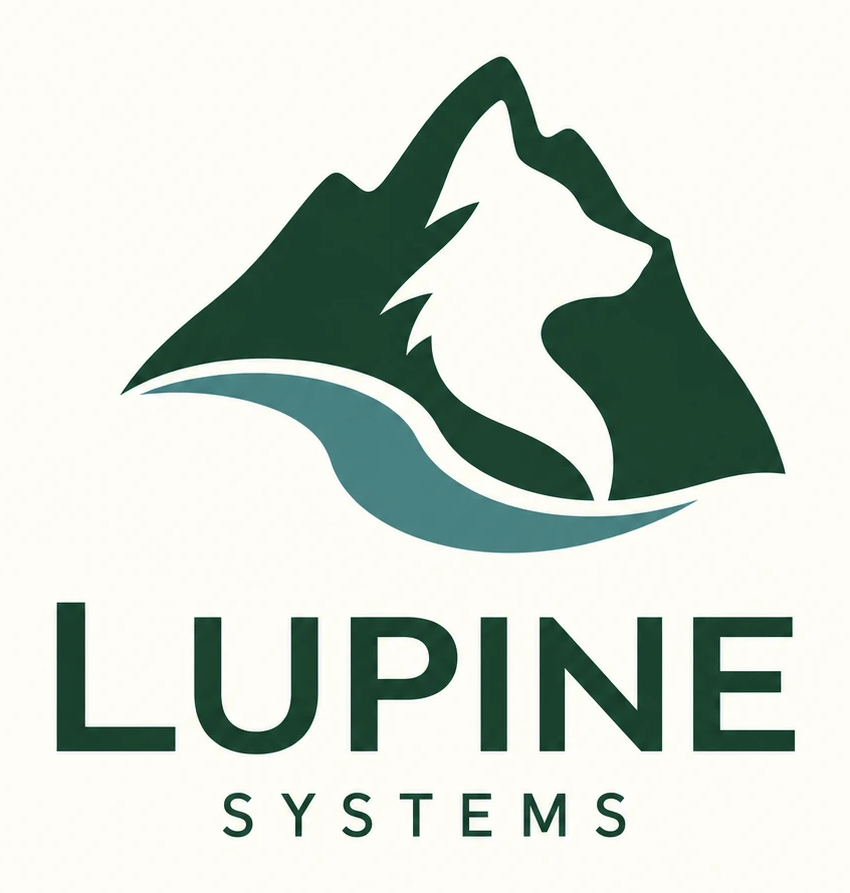
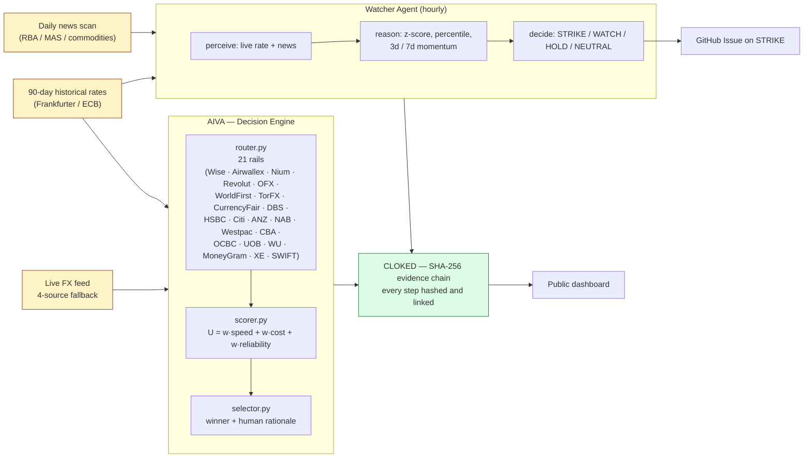
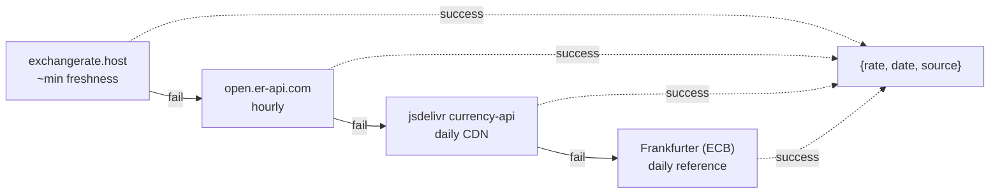
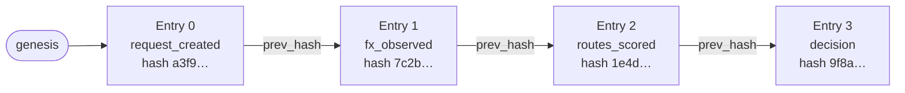
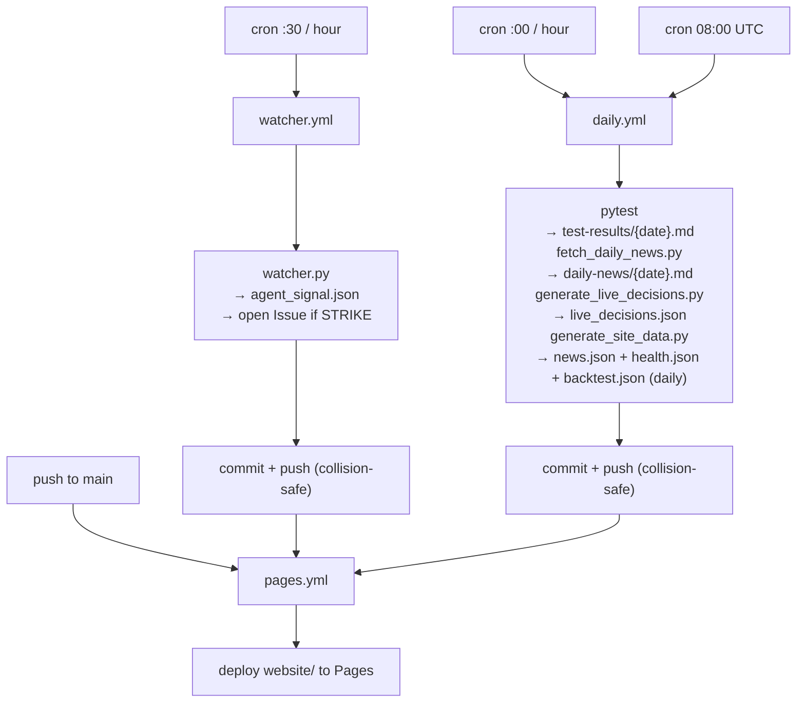

<p align="center">
  
</p>

# Lupine

**Learning and building toward an energy infrastructure technology company, starting in Tasmania.**

Lupine is the project through which Chris Gogoi, an industrial and production engineer in
Hobart, is developing the electrical, computing and software foundations to understand,
design and troubleshoot energy infrastructure, and to find a problem worth building a
company around.

---

## The ambition

A long-term technical career and, eventually, an energy technology company connected to
Tasmania's energy systems and AI infrastructure, potentially serving problems elsewhere.

The repository supports three connected activities:

1. **Understanding**: lessons in electrical fundamentals, measurement, control and
   communications, recorded in the [handbook](docs/handbook/).
2. **Experiments**: safe, low-voltage, reproducible, with raw data kept in
   [`experiments/`](experiments/).
3. **Product discovery**: reading and engineering conversations in [`research/`](research/).

**The product is not chosen yet.** It has to come from evidence: what engineers actually
need, what existing solutions miss, and what experiments show. Lupine's architecture alone
does not establish a market.

---

## What the software implements today

Lupine's three layers are **Aiva** (decides), **Rail** (executes and reconciles) and
**Cloked** (preserves evidence). Their concepts carry forward. Their current code was
written for payments and is being adapted where real engineering requirements justify it.

The part that carries over directly is **Rail's outcome handling** (`src/rail_lite/`). After
sending an instruction, Rail decides only what the evidence supports: completed, failed,
mismatched or **uncertain**. It reconciles uncertainty with fresh evidence, and refuses to
resend while it doesn't know whether the first attempt took effect. The rules are
domain-neutral: the target can be a battery setpoint in kW as easily as a payment.

Details, including every limitation, are in [docs/architecture.md](docs/architecture.md).

---

## Honest status

Labels: **[SIMULATED]** = software only · **[MEASURED]** = observed with our own
instrument · **proposed** = not built.

| Capability | Status | Evidence |
|---|---|---|
| Rail: confirmed vs uncertain outcomes, reconciliation, safe-retry guard | **[SIMULATED]** | 30 deterministic tests; `scripts/rail_uncertainty_demo.py` (a pretend battery) |
| Cloked evidence chain | **[SIMULATED]**, partial | Proves internal consistency only; storing the head hash externally is proposed |
| Any physical measurement or real device | **None yet** | Hardware is postponed until the fundamentals are in place |
| Rail controlling a real low-voltage device | Proposed (Jan–Mar 2027) | — |
| Communication-loss and restart experiments on hardware | Proposed (Apr–Jun 2027) | — |
| Aiva feasibility checks for engineering limits | Proposed | — |
| Payments decision engine, FX feed, watcher | Earlier work, still running | **Not** evidence for an energy product |

Nothing in this repository has yet been physically tested.

---

## Where to start

If you're new to this, in this order:

1. **The handbook:** [docs/handbook/](docs/handbook/). Open the latest PDF in `editions/`. It
   covers the goals, the timeline, how lessons work and the safety rules.
2. **What the code really does:** [docs/architecture.md](docs/architecture.md).
3. **Run it:**
   ```bash
   pip install -r requirements.txt
   PYTHONPATH=. pytest tests/test_aiva.py tests/test_rail.py tests/test_cloked.py
   PYTHONPATH=. python scripts/rail_uncertainty_demo.py
   ```
4. **How records are kept:** [experiments/README.md](experiments/README.md) and
   [research/README.md](research/README.md).

---

## Repository map

| Location | Purpose |
|---|---|
| `docs/handbook/` | Editable learning handbook and preserved PDF editions |
| `docs/architecture.md` | The actual code: boundaries and limitations |
| `experiments/` | Experiment records and raw measurements (the one authoritative copy) |
| `research/` | Sourced reading notes, problem observations, conversation summaries |
| `src/`, `tests/` | Software and its tests |
| `scripts/` | Demo, handbook builder, and earlier payments automation |
| `website/` | Public site (GitHub Pages); brand assets in `website/assets/brand/` |
| `docs/provenance.md` | Where every payments-era figure came from, and the corrections |

---

## Earlier work: payments decision engine (April–October 2026)

> **Historical.** Lupine began as a deterministic decision engine for cross-border payments
> (AUD → SGD). That code still runs at its original paths, and its automations still run on
> schedules. It is preserved as earlier work. **Its outputs are not evidence that an energy
> product works.**

The original mission, as written then:

> Lupine decides how value moves when the cost of getting it wrong is high. Every decision
> is reasoned in public, scored against live market data, and sealed in a tamper-evident
> audit chain — so the *why* behind every recommendation is as durable as the
> recommendation itself.

V0 is the working loop: take a movement request, score 21 modelled payment rails
against the live AUD/SGD rate, pick the best one for the urgency profile,
and produce a SHA-256 evidence chain proving what was decided and why.
A second autonomous agent watches the market hourly and surfaces favourable
transfer windows on its own.

**Live system:** <https://cheeroo2020.github.io/lupine-systems-core>
**Quick read:** [Plain English Guide](./docs/guide.md)

---

### What's running today

| Surface | Status | Refresh cadence | Source |
|---|---|---|---|
| 21-rail decision engine | ✅ live | per request | `src/aiva_lite/router.py` |
| Multi-source FX feed | ✅ live | on demand (4-source fallback chain) | `src/data/fx_feed.py` |
| 90-day backtest | ✅ live | daily | `scripts/backtest.py` |
| Watcher agent (STRIKE / WATCH / HOLD) | ✅ live | hourly | `scripts/watcher.py` |
| CLOKED audit chain | ✅ live | every decision | `src/cloked_lite/logger.py` |
| Daily news + health snapshot | ✅ live | hourly catch-up, fires once/day | `daily.yml` |
| Public website (GitHub Pages) | ✅ live | on every push to `main` | `pages.yml` |

---

### Mission, in one diagram



---

### Why 21 rails

The original V0 had 3 simulated routes. The current system models provider
economics, with hardcoded constants, for every rail a A$500K AUD→SGD payer can practically use:

Fee and settlement figures below are **[ASSUMED]** constants, unverified (`docs/provenance.md`).

| Tier | Rails | Typical fee (bps) | Settlement |
|---|---|---|---|
| Digital-first | Nium, Airwallex, WorldFirst, Revolut, Wise, TorFX, OFX, CurrencyFair | 25 – 55 | 1 – 48 h |
| Bank digital / regional | DBS Remit, XE | 80 – 90 | 18 – 48 h |
| Legacy retail | Western Union, MoneyGram | 120 – 160 | 1 – 2 days |
| Major banks (AU side) | HSBC, Citi, ANZ, NAB, Westpac, CBA | 150 – 225 | 1 – 1.5 days |
| Major banks (SG side) | OCBC, UOB | 200 – 205 | 1 day |
| Generic SWIFT | Bank SWIFT (worst-case baseline) | 250+ | 1.5 days |

**[ASSUMED]** The site's "Wise saves ~A$10,270 vs a generic bank SWIFT transfer"
figure is the difference between two unverified constants (45 vs 250.4 bps).
It is a modelled number, not a measured saving. See `docs/provenance.md`.

---

### Decision engine — urgency-weighted scoring

Composite utility: **U = w·speed + w·cost + w·reliability**

| Urgency | Speed | Cost | Reliability |
|---|--:|--:|--:|
| low | 15% | 55% | 30% |
| normal | 25% | 35% | 40% |
| high | 50% | 15% | 35% |
| critical | 60% | 5% | 35% |

Speed and cost are min-max normalised across the candidate set so the
weights have a comparable dynamic range.

---

### Multi-source FX feed (`src/data/fx_feed.py`)

Designed so a single source outage never breaks the system:



Each source is tried in priority order. The selected source is recorded
on every signal, so the dashboard can show provenance.

---

### CLOKED evidence chain



`verify_chain()` recomputes every hash and checks linkage. Editing an entry → False —
unless the forger recomputes every later hash too, which only a copy of the head hash
stored elsewhere can catch (not yet built).
The watcher and the daily decision generator both use this chain — every
recommendation on the live site has a verifiable evidence trail.

---

### Watcher agent (`scripts/watcher.py`)

Runs every hour at `:30` via `.github/workflows/watcher.yml`. Perceives,
reasons, decides, acts:

1. **Perceive** — fetches live AUD/SGD via the multi-source feed; scans the
   most recent daily-news files for RBA / MAS / commodity keywords.
2. **Reason** — computes z-score, 60-day percentile, 3-day and 7-day momentum.
3. **Decide** — applies a rule set: top decile → `STRIKE`; above-mean +
   confirming news → `STRIKE`; bottom decile → `HOLD`; etc.
4. **Act** — writes `website/data/agent_signal.json` and opens a GitHub
   Issue on a STRIKE day (with duplicate-suppression for the same date).

Every step is appended to a CLOKED chain and the final hash is published
in the signal file for independent verification.

---

### Automation map



Every cron step has `continue-on-error: true` and every commit step does
`git pull --rebase` before pushing, so simultaneous workflow runs never
brick the pipeline.

---

### Recent fixes (May 2026)

- **Backtest daily refresh** — `_backtest_is_stale()` threshold lowered from
  7 days to 1, so the "Last 14 trading days" table moves with the calendar.
- **Date parsing** — `open.er-api.com` returns RFC-2822
  (`"Sat, 02 May 2026…"`), not ISO. Switched to `time_last_update_unix`
  so `rate_date` is always `YYYY-MM-DD`.
- **Brand logos** — Clearbit's free Logo API was deprecated post-acquisition.
  Swapped to Google's S2 favicon API with a coloured-initial fallback so
  every provider card has a visible identity even if the favicon fails.
- **21 rails** — expanded from 3 simulated routes to 21 real provider models
  covering fintechs, regional banks, and the AU/SG big-bank set.
- **Multi-source FX** — single Frankfurter dependency replaced with a
  4-source fallback chain.
- **Workflow hardening** — added `git pull --rebase` and
  `continue-on-error` to both `daily.yml` and `watcher.yml` commit steps,
  eliminating the "two crons pushed at the same time" failure mode.

---

### Quick start

```bash
pip install -r requirements.txt

# run the FastAPI loop locally
uvicorn src.api.main:app --reload

# refresh the live decisions JSON manually
PYTHONPATH=. python scripts/generate_live_decisions.py

# run the watcher manually
PYTHONPATH=. python scripts/watcher.py

# regenerate the 90-day backtest
PYTHONPATH=. python scripts/backtest.py
```

---

### Payments system status

| Component | State |
|---|---|
| 21-rail decision engine | ✅ |
| Multi-source FX feed | ✅ |
| Watcher agent (hourly) | ✅ |
| Daily news + health pipeline | ✅ |
| 90-day backtest (daily refresh) | ✅ |
| CLOKED evidence chain | ✅ |
| Public dashboard (Pages) | ✅ |
| FastAPI (9 endpoints; `/chat` inactive without a paid key) | ✅ |
| Deterministic test suite (30 tests) | ✅ |
| CI (every push) | ✅ |

---

## License

See [LICENSE](LICENSE). © Chirantan Gogoi.
